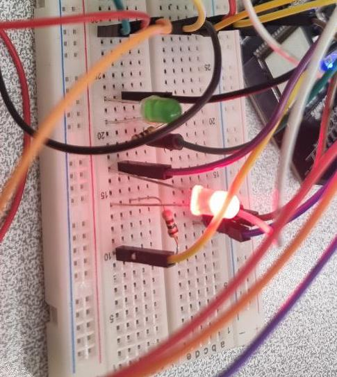
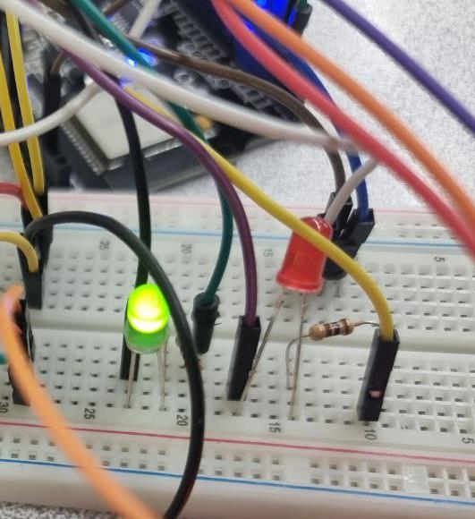
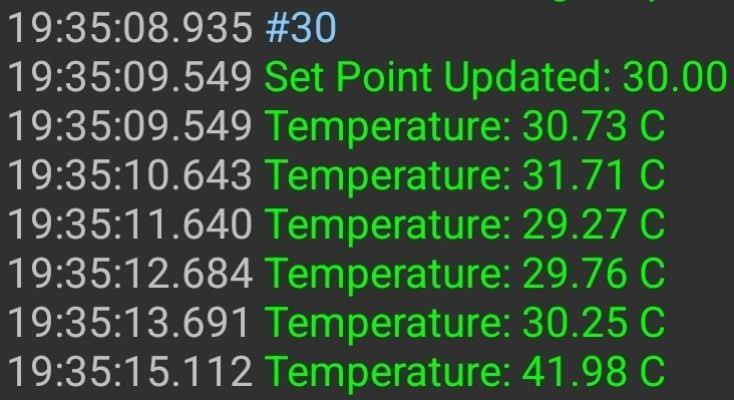
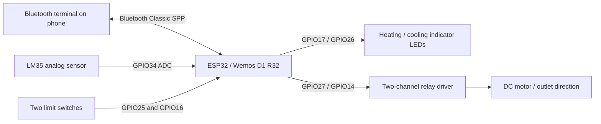

# ESP32 Wireless Temperature & Airflow Controller

**Bluetooth-enabled temperature monitoring and directional airflow control** using an ESP32, analog temperature sensing, relay-driven DC motor control, and limit-switch feedback.

The prototype accepts wireless temperature setpoints and direction commands, measures ambient temperature, and drives LED indicators representing heating and cooling states. A small motor and relay pair represent an adjustable air outlet. Its controller uses a **±5°C neutral band** around the target temperature.

> **Prototype scope:** This is a hardware demonstration with heater/fan **LED indicators**, not an electrically or thermally certified heater, HVAC system, or internet-connected/cloud IoT service. The provided firmware uses **Bluetooth Classic Serial Port Profile (SPP)**. It does **not** implement Wi-Fi, MQTT, cloud dashboards, or Bluetooth Low Energy.

## Highlights

- **Wireless commands:** Bluetooth Classic SPP terminal interface on the ESP32.
- **Analog temperature sensing:** LM35 connected to ESP32 ADC GPIO34, with a firmware-specific calibration formula that must be checked against the actual circuit.
- **Threshold-based thermal control:** heating/cooling indication beyond the ±5°C band; both indicators off inside the band.
- **Air outlet direction:** relay-controlled motor movement and two directional limit-switch inputs.
- **Direct override:** documented `R`, `L`, and `F` commands plus numeric setpoint input.
- **Documented prototype evidence:** saved hardware and Bluetooth-terminal photos extracted from the original engineering report.

## Prototype photos

| Heating indication | Cooling indication |
| :---: | :---: |
|  |  |

| Wireless temperature readings | Bluetooth direction commands |
| :---: | :---: |
|  |  |

## System overview

## Temperature control behavior

Given target `setpoint` and `deadband = 5.0` °C, the firmware intends the following:

| Measured temperature | Indicators | Intended outlet behavior |
| --- | --- | --- |
| `T < setpoint - 5°C` | Heater ON, fan OFF | Turn right |
| `setpoint - 5°C <= T <= setpoint + 5°C` | Both OFF | Return toward center |
| `T > setpoint + 5°C` | Heater OFF, fan ON | Turn left |

This is a **10°C-wide neutral region** (±5°C from the setpoint), not a 5°C total-width deadband. The source does not implement a full PID regulator or verified hysteresis state machine. The motor controls also depend on limit-switch readings and Bluetooth commands, as explained in [control behavior](docs/CONTROL_LOGIC.md).

## Hardware and source

- **Controller:** Wemos D1 R32 / classic ESP32-compatible board
- **Wireless link:** `BluetoothSerial.h` using Bluetooth Classic SPP
- **Sensor:** LM35 analog temperature sensor
- **Actuators:** two LED indicators and a relay-controlled DC motor
- **Feedback:** two end-of-travel limit switches
- **Firmware:** [`firmware/temperature_airflow_controller/temperature_airflow_controller.ino`](firmware/temperature_airflow_controller/temperature_airflow_controller.ino)

See [hardware and GPIO mapping](docs/HARDWARE.md), [wireless command reference](docs/BLUETOOTH_PROTOCOL.md), and [setup instructions](docs/SETUP.md).

## Quick start

1. Install Arduino IDE with ESP32 board support, and choose your board's compatible ESP32 configuration.
2. Inspect the [wiring and electrical safety guidance](docs/HARDWARE.md) and confirm the real power/relay/ADC circuitry before connecting hardware.
3. Open `firmware/temperature_airflow_controller/temperature_airflow_controller.ino` in the Arduino IDE and upload it to the ESP32.
4. Pair a Bluetooth Classic SPP-capable terminal with device **`ESP32-WROOM-32`**. Send a number followed by a newline (e.g. `30`), or a single-letter motor command (`R`, `L`, `F`).
5. Observe device output and LED indicators. **The original sketch has command-handling and stop-state limitations**; do not connect a real heater or unattended actuator without hardening and validating the control and safety logic.

The original sketch is preserved without functional modifications. The source report documents a physical prototype; this repository has **not recompiled or hardware-tested** the firmware.

## Repository layout

| Directory | Contents |
| --- | --- |
| `firmware/` | Original, byte-preserved ESP32 Arduino sketch |
| `media/` | Selected original prototype and Bluetooth terminal photos |
| `docs/` | Circuit notes, pin assignments, protocol, control flow, safety, and verification |
| `scripts/` | Non-invasive source consistency check |
| `tests/` | Static checks of source/pin map and project layout |
| `.github/workflows/` | CI for source consistency and test execution (no hardware simulation) |

## Verification and limitations

- Software checks confirm source files, distinct GPIO definitions, presence of Bluetooth commands, and expected feature tokens. They **do not** validate electrical behavior or firmware compilation.
- The code uses an empirical temperature expression `sensorValue * 0.489 - 80`; the report describes sensor calibration but does not supply a verified ADC calibration certificate.
- Bluetooth remote commands may be consumed by a serial-echo block before reaching the command handler; `F` is not a verified fail-safe shutdown.
- Some limit-switch behaviors in the code and hardware notes require bench validation, including safe travel limits.

Read [review and known issues](docs/REVIEW.md) before relying on the controller for any heating/motion device.

## Attribution

The supplied engineering report credits **Arian Abdollahi, Sepehr Ghalebi, and Mohammad Sadegh Rezvani**. Source photos and firmware were provided with the project materials; individual authorship per component is not specified. No repository-wide reuse license is inferred. See [CREDITS.md](CREDITS.md).
